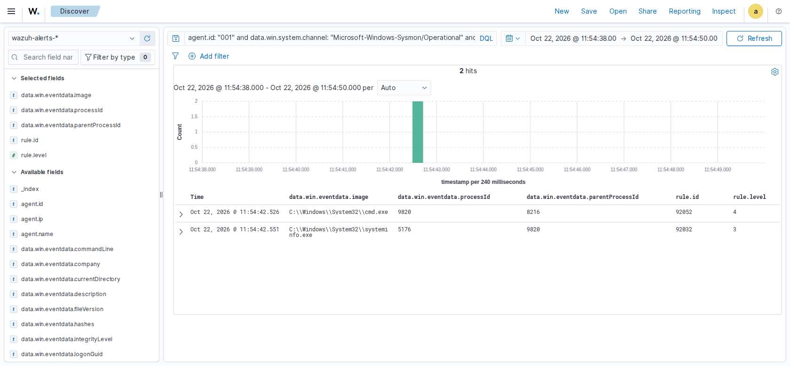
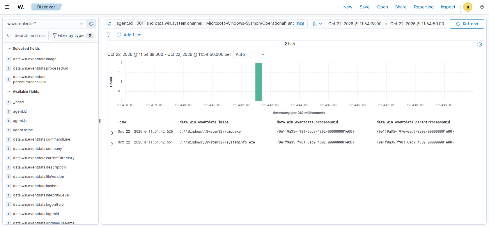
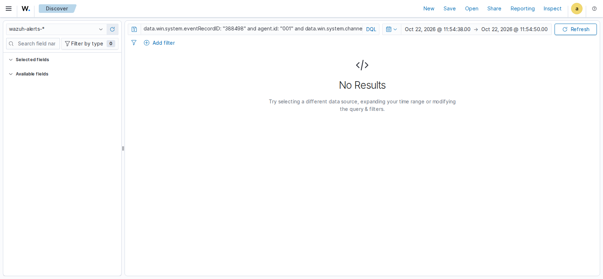

A command that prints information about a computer can come from an administrator doing their job or from an attacker who has just landed on the machine. The command is the same in both cases. So how do you tell the difference?

I'm not going to answer that in one blog post. But I wanted to get closer to what a SOC analyst does all day, so I started with a smaller question: if I run a known technique in my own lab, can I rebuild what happened and connect the traces on the machine to the alerts in the dashboard?

On 22 October I ran a single Atomic Red Team test. The result was three process creations in Sysmon and two matching alerts in Wazuh. How those pieces fit together, and where the evidence runs out, is what this post is about.

## The lab

Nothing exotic. Everything runs on one Linux Mint machine:

- a **Windows 11 virtual machine** on QEMU/KVM, with [Sysmon](https://learn.microsoft.com/en-us/sysinternals/downloads/sysmon) 15 logging system activity and the Wazuh agent forwarding it;
- a single-node **Wazuh 4.14** stack (manager, indexer, dashboard) running in Docker on the host;
- a NAT network between the two. The dashboard and API are only reachable from localhost, and the VM can reach the agent ports and nothing else.

I work on the VM over SSH with a dedicated key, and I took a snapshot before installing any attack tooling, so there's always a clean state to go back to.

## One small, boring test

[Atomic Red Team](https://github.com/redcanaryco/atomic-red-team) is a library of small tests, each one reproducing a technique from MITRE ATT&CK. I picked **System Information Discovery** ([T1082](https://attack.mitre.org/techniques/T1082/)), and from it one specific test that runs two commands:

```cmd
systeminfo
reg query HKLM\SYSTEM\CurrentControlSet\Services\Disk\Enum
```

The first prints details about the operating system and hardware. The second reads a registry key about the disks, something malware often does to check whether it's inside a virtual machine. Both are read-only and neither changes anything on the system.

I chose it because it's boring. A noisy test with obvious malicious behaviour would light up the dashboard and teach me very little. A quiet one, made of commands that are legitimate most of the time, is closer to what real triage looks like.

I ran it like this, pinned to a single test GUID so I knew exactly what would execute:

```powershell
Invoke-AtomicTest T1082 -TestGuids '66703791-c902-4560-8770-42b8a91f7667'
```

The test finished with exit code `0`. But "the tool said it worked" isn't evidence, so I didn't stop there.

## Rebuilding the sequence

My guess was that `cmd.exe` would start `systeminfo.exe` and then `reg.exe`. Sysmon's Event ID 1, which records every process creation, showed this:

- 11:54:41.261 UTC: `cmd.exe` (Record ID 388486)
- 11:54:41.317 UTC: `systeminfo.exe` (Record ID 388488)
- 11:54:45.382 UTC: `reg.exe` (Record ID 388498)

Three processes within about four seconds, and the command line of `cmd.exe` contains both instructions from the test. That looks convincing, but being close in time doesn't prove they belong together. In that same window Sysmon logged 18 process creations, and I couldn't just assume the others belonged to my test.

The real link is the process GUID. Sysmon gives every process a unique `ProcessGuid` and records its parent's as `ParentProcessGuid`. Both `systeminfo.exe` and `reg.exe` pointed back to the GUID of that exact `cmd.exe`, which had been started by the PowerShell running Atomic:

```text
powershell.exe (Atomic framework)
└── cmd.exe
    ├── systeminfo.exe
    └── reg.exe
```

Why GUIDs and not PIDs? Because Windows reuses PIDs. A GUID stays unique, so the chain holds even on a busy machine.

## Finding the same traces in Wazuh

Next came the dashboard. I filtered by the lab agent, the Sysmon channel and a twelve-second window around the test. Two built-in alerts came back:



*The filtered view shows the two alerts I selected for correlation. It isn't everything that happened in the session.*

- `cmd.exe` triggered rule **92052**, level 4.
- `systeminfo.exe` triggered rule **92032**, level 3.

I didn't write any custom rules to get them. These come with Wazuh.

To be sure these were *my* processes and not lookalikes, I compared Record IDs and GUIDs with the local Sysmon log, not just names and times. The `ParentProcessGuid` of `systeminfo.exe` in Wazuh is the `ProcessGuid` of `cmd.exe`, exactly as on the endpoint:



*The parent GUID of systeminfo.exe matches the process GUID of cmd.exe. That's stronger evidence than two events being close in time.*

## The event that didn't show up

Then I looked for `reg.exe`. It's in the local Sysmon log, with its Record ID and the right parent. In the Wazuh alerts index, for the same window, there was nothing:



*Searching by agent and Record ID 388498. I extended the window to 12:00 UTC and it still returned nothing.*

It would be easy to write "Wazuh missed it" here, and it would be wrong. The alerts index only holds events that matched a rule. It isn't an archive of everything the agent collected. An event with no alert may have been collected and simply not matched anything. What I can say is narrower: the event exists on the endpoint, and it isn't in the alerts. Why, and whether it should be, is the next thing I want to trace through the pipeline.

One more thing I had to read carefully: the labels. My test is T1082, but the alerts are tagged T1059.003 (Windows Command Shell) and, for rule 92032, also T1087. Those tags describe what each *rule* looks for. They don't tell you how well the technique I simulated is covered.

## What went wrong along the way

Two things didn't work the first time, and I think they're worth mentioning.

My first attempt to launch the script over SSH failed before it started: I sent it as an encoded command and it exceeded the Windows command-line length limit. I copied the script over SFTP and ran it from a file instead.

Then my first query to collect the Sysmon events came back empty. The events were there; my query wasn't finding them. I exported the same records with `wevtutil` and did *not* run the test a second time, because a second run would have created a second set of events and muddied the timeline.

## The triage decision

My verdict for this case: **authorised lab activity**. The commands, the timing and the process tree all match the test I planned. The evidence documents an execution and two matching alerts. It doesn't show a compromise, and it doesn't prove that T1082 is fully covered.

In a real environment, the same alerts would send me looking for more. Did this user have a reason to run these commands? Is PowerShell starting `cmd.exe` normal on this machine? What happened just before and just after? A single discovery command often has a dull explanation, and sometimes it doesn't.

What stayed with me from this exercise is that an alert on its own says very little. It starts to mean something when you tie it to a process, a command line and the context around them.

## What's next

- Follow the `reg.exe` event through Wazuh to see where it stops, and decide whether it deserves a rule.
- Run more techniques and build up a small set of triage notes like this one.
- Try the detection ideas from my [static analysis of a Windows backdoor](/posts/kugou-dll-static-analysis/) against safe simulations in this lab.
