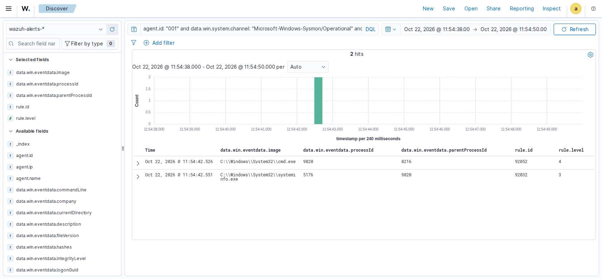
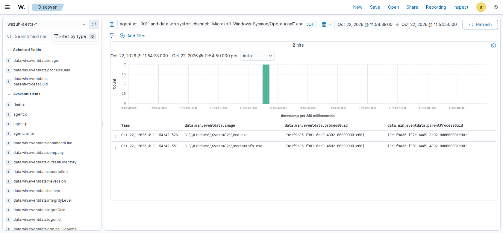
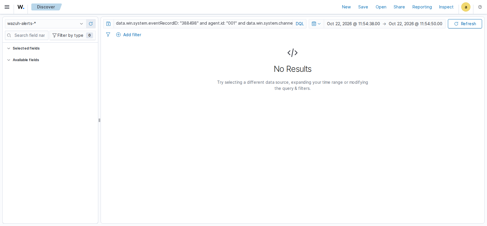

Un comando che mostra informazioni su un computer può arrivare da un amministratore che fa il suo lavoro oppure da un attaccante appena entrato nella macchina. Il comando è lo stesso in entrambi i casi. Come si distingue una cosa dall'altra?

Non pretendo di rispondere in un post. Volevo però avvicinarmi a quello che un analista SOC fa tutto il giorno, quindi sono partito da una domanda più piccola: se eseguo una tecnica nota nel mio laboratorio, riesco a ricostruire cosa è successo e a collegare le tracce sulla macchina agli alert nella dashboard?

Il 22 ottobre ho eseguito un singolo test di Atomic Red Team. Il risultato: tre creazioni di processo in Sysmon e due alert corrispondenti in Wazuh. Questo post racconta come quei pezzi si collegano tra loro e dove finiscono le prove.

## Il laboratorio

Niente di esotico. Gira tutto su una sola macchina Linux Mint:

- una **macchina virtuale Windows 11** su QEMU/KVM, con [Sysmon](https://learn.microsoft.com/it-it/sysinternals/downloads/sysmon) 15 che registra l'attività del sistema e l'agente Wazuh che la inoltra;
- uno stack **Wazuh 4.14** single-node (manager, indexer, dashboard) in Docker sull'host;
- una rete NAT tra i due. Dashboard e API sono raggiungibili solo da localhost, e la VM può raggiungere le porte dell'agente e nient'altro.

Lavoro sulla VM via SSH con una chiave dedicata, e prima di installare qualsiasi strumento di attacco ho fatto uno snapshot, così c'è sempre uno stato pulito a cui tornare.

## Un test piccolo e noioso

[Atomic Red Team](https://github.com/redcanaryco/atomic-red-team) è una raccolta di piccoli test, ognuno dei quali riproduce una tecnica di MITRE ATT&CK. Ho scelto **System Information Discovery** ([T1082](https://attack.mitre.org/techniques/T1082/)) e, al suo interno, un test specifico che esegue due comandi:

```cmd
systeminfo
reg query HKLM\SYSTEM\CurrentControlSet\Services\Disk\Enum
```

Il primo stampa i dettagli di sistema operativo e hardware. Il secondo legge una chiave di registro relativa ai dischi, cosa che il malware fa spesso per capire se si trova dentro una macchina virtuale. Sono entrambi di sola lettura e nessuno dei due modifica il sistema.

L'ho scelto proprio perché è noioso. Un test rumoroso, con comportamenti chiaramente malevoli, accenderebbe la dashboard e mi insegnerebbe ben poco. Uno silenzioso, fatto di comandi che quasi sempre sono legittimi, somiglia di più al triage vero.

L'ho eseguito così, vincolato a un solo GUID di test per sapere con esattezza cosa sarebbe partito:

```powershell
Invoke-AtomicTest T1082 -TestGuids '66703791-c902-4560-8770-42b8a91f7667'
```

Il test si è chiuso con codice di uscita `0`. Ma "lo strumento dice che ha funzionato" non è una prova, quindi non mi sono fermato lì.

## Ricostruire la sequenza

La mia ipotesi era che `cmd.exe` avviasse `systeminfo.exe` e poi `reg.exe`. L'Event ID 1 di Sysmon, che registra ogni creazione di processo, mostrava questo:

- 11:54:41.261 UTC: `cmd.exe` (Record ID 388486)
- 11:54:41.317 UTC: `systeminfo.exe` (Record ID 388488)
- 11:54:45.382 UTC: `reg.exe` (Record ID 388498)

Tre processi in circa quattro secondi, e nella riga di comando di `cmd.exe` compaiono entrambe le istruzioni del test. Sembra convincente, ma la vicinanza nel tempo non dimostra che siano collegati. In quella stessa finestra Sysmon ha registrato 18 creazioni di processo, e non potevo dare per scontato che le altre facessero parte del mio test.

Il legame vero è il GUID del processo. Sysmon assegna a ogni processo un `ProcessGuid` univoco e registra quello del padre come `ParentProcessGuid`. Sia `systeminfo.exe` sia `reg.exe` puntavano al GUID di quello specifico `cmd.exe`, avviato a sua volta dal PowerShell che eseguiva Atomic:

```text
powershell.exe (framework Atomic)
└── cmd.exe
    ├── systeminfo.exe
    └── reg.exe
```

Perché i GUID e non i PID? Perché Windows i PID li riutilizza. Un GUID resta univoco, quindi la catena regge anche su una macchina con molta attività.

## Ritrovare le stesse tracce in Wazuh

Poi sono passato alla dashboard. Ho filtrato per l'agente del laboratorio, il canale Sysmon e una finestra di dodici secondi intorno al test. Sono usciti due alert nativi:



*La vista filtrata mostra i due alert che ho selezionato per la correlazione. Non è tutto quello che è successo durante la sessione.*

- `cmd.exe` ha fatto scattare la regola **92052**, livello 4.
- `systeminfo.exe` ha fatto scattare la regola **92032**, livello 3.

Non ho scritto regole personalizzate per ottenerli. Sono quelle incluse in Wazuh.

Per essere sicuro che fossero proprio i *miei* processi e non dei sosia, ho confrontato Record ID e GUID con il log Sysmon locale, non solo nomi e orari. Il `ParentProcessGuid` di `systeminfo.exe` in Wazuh è il `ProcessGuid` di `cmd.exe`, esattamente come sull'endpoint:



*Il GUID del padre di systeminfo.exe coincide con il GUID di cmd.exe. È una prova più solida di due eventi vicini nel tempo.*

## L'evento che non è comparso

Poi ho cercato `reg.exe`. Nel log Sysmon locale c'è, con il suo Record ID e il padre giusto. Nell'indice degli alert di Wazuh, per la stessa finestra, non c'era nulla:



*Ricerca per agente e Record ID 388498. Ho esteso la finestra fino alle 12:00 UTC e non è uscito comunque niente.*

Sarebbe facile scrivere "Wazuh non l'ha visto", e sarebbe sbagliato. L'indice degli alert contiene solo gli eventi che hanno fatto scattare una regola. Non è un archivio di tutto ciò che l'agente ha raccolto. Un evento senza alert può essere stato raccolto senza corrispondere ad alcuna regola. Quello che posso dire è più limitato: l'evento esiste sull'endpoint e tra gli alert non c'è. Il perché, e se dovrebbe esserci, è la prossima cosa che voglio seguire lungo la pipeline.

Un'altra cosa da leggere con attenzione sono le etichette. Il mio test è T1082, ma gli alert sono etichettati T1059.003 (Windows Command Shell) e, per la regola 92032, anche T1087. Quelle etichette descrivono cosa cerca ciascuna *regola*. Non dicono quanto sia coperta la tecnica che ho simulato.

## Cosa è andato storto lungo la strada

Due cose non hanno funzionato al primo colpo, e mi sembra giusto raccontarle.

Il primo tentativo di lanciare lo script via SSH è fallito ancora prima di partire: l'avevo inviato come comando codificato e superava il limite di lunghezza della riga di comando di Windows. Ho copiato lo script via SFTP e l'ho eseguito da file.

Poi la prima query per raccogliere gli eventi Sysmon è tornata vuota. Gli eventi c'erano, era la mia query a non trovarli. Ho esportato gli stessi record con `wevtutil` e *non* ho rieseguito il test, perché una seconda esecuzione avrebbe creato un secondo gruppo di eventi e confuso la timeline.

## La decisione di triage

Il mio verdetto per questo caso: **attività di laboratorio autorizzata**. Comandi, orari e albero dei processi corrispondono al test che avevo pianificato. Le prove documentano un'esecuzione e due alert corrispondenti. Non mostrano una compromissione e non dimostrano che T1082 sia coperta del tutto.

In un ambiente reale, gli stessi alert mi porterebbero a cercare altro. L'utente aveva un motivo per eseguire quei comandi? È normale che su quella macchina PowerShell avvii `cmd.exe`? Cosa è successo subito prima e subito dopo? Un singolo comando di discovery ha spesso una spiegazione banale, e a volte no.

Da questo esercizio mi è rimasta soprattutto una cosa: un alert da solo dice molto poco. Comincia ad avere un significato quando lo colleghi a un processo, a una riga di comando e al contesto che li circonda.

## Prossimi passi

- Seguire l'evento `reg.exe` dentro Wazuh per vedere dove si ferma, e decidere se merita una regola.
- Eseguire altre tecniche e mettere insieme una piccola raccolta di note di triage come questa.
- Provare le idee di detection della mia [analisi statica di una backdoor Windows](/it/posts/kugou-dll-static-analysis/) con simulazioni sicure in questo laboratorio.
